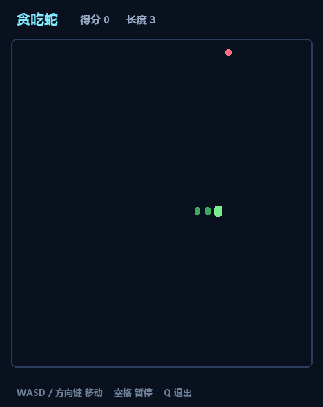

# Test · 终端贪吃蛇

[](https://github.com/Meowmeowoww/Test/actions/workflows/ci.yml)
[](LICENSE)

一个用 C++17 写的终端版贪吃蛇，单文件、零第三方依赖，Windows / Linux / macOS 都能编译。



## 玩法

- **W A S D** 或**方向键**控制方向
- **空格** 暂停 / 继续
- **Q** 或 **Esc** 退出
- 吃到 `*` 得分 +1、身体长一格，速度随之加快
- 撞墙或撞到自己就游戏结束，按 **R** 重开

## 编译

### Windows（MSVC）

在 **x64 Native Tools Command Prompt** 里：

```bat
build.bat
```

或者直接用 cl：

```bat
cl /std:c++17 /EHsc /O2 /utf-8 snake.cpp /Fe:snake.exe
```

### Linux / macOS

```bash
g++ -std=c++17 -O2 -o snake snake.cpp
```

### CMake（跨平台）

```bash
cmake -S . -B build
cmake --build build
```

## 运行

```bash
./snake            # Windows 下是 snake.exe
```

第一次在 Windows 上运行如果中文显示成乱码，把终端字体换成「Consolas」或「Cascadia Mono」即可——程序本身已经打开了 UTF-8 输出。

## 自测

不进入交互，只跑一遍游戏逻辑（撞墙、自撞、吃食物、反向输入等），全部通过时退出码为 0：

```bash
./snake --selftest
```

```
[PASS] 初始长度是 3
[PASS] 第一步不会死
[PASS] 向右走了一格
[PASS] 反方向输入被忽略
[PASS] 撞墙会死
[PASS] 吃到食物长一格
[PASS] 得分 +1
[PASS] 撞到自己会死
[PASS] 食物落在棋盘内
[PASS] 食物不压在蛇身上

全部通过
```

## 实现要点

- **单文件**：`snake.cpp` 里分成「终端控制 / 游戏逻辑 / 画面 / 自测」四段
- **无阻塞输入**：Windows 用 `_kbhit`，POSIX 用 `select` + 原始模式
- **画面不闪**：整帧拼成一个字符串一次性输出，光标用 `\x1b[H` 回到左上角
- **方向校验**：只和上一帧的方向比，避免一帧内连按两下实现原地掉头
- **自撞判定**：不吃东西时尾巴会让开一格，所以撞到「即将离开的尾格」不算死

## 目录

```
.
├── snake.cpp       # 全部代码
├── build.bat       # Windows 编译脚本
├── CMakeLists.txt  # CMake 构建
├── .gitignore
└── README.md
```
